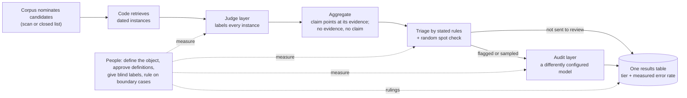

# CMH Skills: Corpus–Model–Human verification

[中文说明](README.zh-CN.md)

An agent skill and a small Python toolkit for linguistics and social-science research in which
language models read corpus instances: judging word senses, dating first attestations, coding
documents with a codebook, classifying stance or frames. It gives a workflow, templates and
scripts so that the results can be checked, and says what people have to do themselves.

The skill follows the `SKILL.md` format used by Claude Code and other agents that support agent
skills. The scripts are plain Python (3.11+, standard library only) and work without any agent.

## Our position

We do not trust language models. We still want them to do reliable work.

CMH does not make a model trustworthy. It arranges the work so that trust is not needed:

- every claim rests on an instance retrieved from a corpus, never on what a model remembers;
- every model layer is measured against blind human judgments;
- every reported result carries the tier of its evidence and the measured error rate of that tier;
- where the evidence is not enough, no claim is made.

## The CMH model

CMH divides verification among the **corpus**, the **models** and the **people**.



### Mechanisms

| Mechanism | What it does | What it prevents |
|---|---|---|
| Corpus nomination | candidates come from scanning the corpus or from a closed list used in full; models only classify them, or enumerate where the corpus cannot nominate | a candidate list limited to what someone happened to remember |
| Retrieval by code | code fetches instances with dates and context; models are never asked for dates, sources or examples | dates and examples invented from model memory |
| Judge layer | one model call per instance against a reviewed definition; every call kept in an append-only ledger | silent re-runs, lost outputs, mixed prompt versions |
| Aggregation with abstention | a claim points at the instance it rests on; without one, the unit gets no claim; values at the edge of a source's time window are marked as bounds | answers for every unit whether or not evidence exists; trends that are only window arithmetic |
| Triage by stated rules | written rules (short or ambiguous forms, window edges, isolated early hits, single supporting instances) send claims to review, plus a seeded random sample of the rest | relying on model confidence, which cannot flag confident errors |
| Audit layer | a differently configured model re-reads the claims sent to review; its false overturns are measured too | self-confirmation, and blind faith in a stronger model |
| Human yardstick | blind, independent labels, first among people, then for every layer, by language and class | model numbers with nothing to be read against |
| Adjudication | the researcher rules on cases that depend on what the research object is, and records the ruling | boundary questions settled by accident or by majority |
| Evidence tiers | each claim carries the strength of its evidence; a lower tier never overrides a higher one; search counts give bounds only | weak evidence presented as strong |
| Frozen protocol | definitions, prompts, rules and decision rules are hashed and committed before evaluation | rules adjusted after seeing results |
| One results table, checks and instruments | every number comes from one table; written checks and diffs run on every rebuild; read-only views (funnel, agreement, cost, ...) are recomputed | cross-wired rows behind "all tests pass", overwritten manual inputs, hand-computed numbers |

## What people have to do

| Who | Task | When |
|---|---|---|
| Researcher | define the unit, the property judged, the claim, the observation windows | before anything runs |
| Researcher | decide what each source can support (evidence tiers) | before anything runs |
| Researcher | read and approve every definition or codebook entry | before models use them |
| Two or more annotators | label a blind pilot independently, so human agreement is known per class | before choosing a model |
| Researcher | freeze the protocol, including what each possible result will mean | before the evaluation run |
| Two or three readers | label the outputs of every condition blind, as the ground truth for every layer | after the pipeline runs |
| Researcher | rule on boundary cases and record the rulings | whenever they come up |
| Researcher | sign off the results and the wording of every claim | before publication |

When given the files to check against, the scripts refuse some shortcuts: definitions not marked
approved, protocol files changed since they were frozen, sheets that would show model answers or
sources, a key folder inside the sheet folder. Nothing in the code can do these tasks for you.

## Use it for

Studies whose claims are built from reading corpus instances one by one, where a written definition
can be applied by trained people and blind human samples can be drawn:

- **dating**: first attestations of words, senses, loanwords, neologisms, terms, slogans;
- **proportions and trends**: sense shares over time, framing or stance shares, topic shares;
- **presence or absence**: whether something is attested in a period or register (with a measured miss rate);
- **comparisons**: registers, outlets, countries, parallel corpora;
- **coded variables**: document coding with a codebook, with corrections before statistical modelling.

`skills/cmh-corpus-verification/references/scenarios.md` explains what changes for each claim type.

## Do not use it for

- statistics that need no instance reading (frequencies, collocations, embeddings);
- tasks where trained people cannot agree: fix the definition first;
- facts no corpus attests: model memory is not evidence;
- decisions about individual people (clinical, legal, hiring, moderation, surveillance);
- material you are not allowed to process (copyright, terms of use, personal data, ethics approval);
- projects with no human time at all.

## Installation

Requirements: Python 3.11 or later. No third-party packages.

For Claude Code, copy (or symlink) the skill folder into your personal or project skills folder:

```bash
git clone https://github.com/subarasi520/cmh-skills.git
cp -r cmh-skills/skills/cmh-corpus-verification ~/.claude/skills/
# or, for one project: cp -r cmh-skills/skills/cmh-corpus-verification <project>/.claude/skills/
```

Other agents that read `SKILL.md` skills: put the folder where that agent looks for skills.
Without an agent: use the scripts directly; every script has `--help`.

## Quick start

Run the complete workflow offline on a synthetic toy corpus (keyword stand-ins replace the models,
and three readers are simulated):

```bash
python3 examples/toy/run_example.py
python3 -m unittest discover -s tests
```

For a real study, copy `skills/cmh-corpus-verification/templates/` into your project, fill in the
protocol, and follow `references/workflow.md`. Connect the judge to a model with an
OpenAI-compatible endpoint (a local server or a hosted API) or to any command-line program.

## Repository layout

```
skills/cmh-corpus-verification/
  SKILL.md, SKILL.zh-CN.md      the skill (English for agents; Chinese version alongside)
  references/                   workflow, scenarios, evidence, annotation, statistics, failure patterns (EN + ZH), glossary
  templates/                    protocol, prompts, judge/audit configs, triage rules, table checks, number registry, annotator guide
  scripts/                      cmh_*.py tools (standard library only)
examples/toy/                   synthetic end-to-end example
tests/                          unit and end-to-end tests
```

## Safety and privacy

- The scripts read and write only the files you name. They send nothing anywhere unless you
  configure a model backend: `cmh_judge.py` then calls the endpoint or program in your
  configuration, and nothing else.
- API keys are read from environment variables at run time and are never written to files.
- Full prompts are not stored in the ledger unless you enable it, because they contain corpus text.
- A `command` backend executes the program named in the configuration. Read configuration files
  from other people before running them, as you would read code.
- Do not commit corpora, answer keys, ledgers with corpus text, or keys. `.gitignore` covers common names.
- Sheets for annotators escape cells that spreadsheet programs could execute as formulas.

See [SECURITY.md](SECURITY.md) for details and for reporting a vulnerability.

## Disclaimer

This project is provided "as is", without warranty of any kind. It is a methodological aid and does
not guarantee correct results. The authors and contributors are not responsible for how it is used
or for any consequence of its use, including research conclusions, publications, decisions, data
handling, costs of model services, and compliance with laws, licences, terms of service,
data-protection rules or ethics requirements. Users are responsible for their data, their models,
their configurations and their conclusions. Full text: [DISCLAIMER.md](DISCLAIMER.md).

## License

MIT. See [LICENSE](LICENSE).

## Contributing

Issues and pull requests are welcome. Please read [CONTRIBUTING.md](CONTRIBUTING.md): synthetic data
only, no secrets, tests for every statistical change, English and Chinese docs kept in step.
