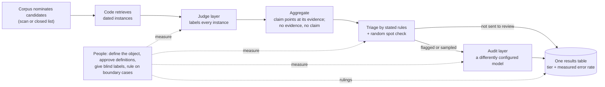

# CMH Skills: Corpus–Model–Human verification

[中文说明](README.zh-CN.md)

**Version 1.0.0** · [Changelog](CHANGELOG.md)

An [Agent Skills](https://agentskills.io) skill and a small Python toolkit for linguistics and
social-science research in which language models read corpus instances: judging word senses,
dating first attestations, coding documents with a codebook, classifying stance or frames. It
gives your agent a workflow, templates and scripts so that the results can be checked, and it
says what people have to do themselves.

It works with Claude Code, Codex, Cursor, Gemini CLI, GitHub Copilot, OpenCode, Cline, Amp and
other agents that read `SKILL.md` skills. The scripts are plain Python 3.11+ (standard library
only) and also work without an agent.

## Start in 30 seconds

```bash
npx skills add https://github.com/subarasi520/cmh-skills --skill cmh-corpus-verification -g
```

This needs Node.js 22.20 or later. The installer asks which of your agents to install to. Leave
out `-g` to install into the current project only.

Or give this to any AI agent that can run shell commands:

```text
Install the cmh-corpus-verification skill for me. If Node.js 22.20 or later is available, run: npx skills add https://github.com/subarasi520/cmh-skills --skill cmh-corpus-verification -g -y. Otherwise clone https://github.com/subarasi520/cmh-skills and copy its folder skills/cmh-corpus-verification into the folder you load skills from (~/.claude/skills/ for Claude Code; ~/.agents/skills/ for Codex, Cursor, Gemini CLI, GitHub Copilot, OpenCode and most others). Then tell me where it is installed and the version written in its SKILL.md.
```

Already installed? Update with:

```text
Update the cmh-corpus-verification skill. If it was installed with the skills CLI, run: npx skills update cmh-corpus-verification -g -y. If it was copied from a clone, run git pull in the clone and copy skills/cmh-corpus-verification again. Then tell me the version written in its SKILL.md.
```

Then just tell your agent:

```text
I have a newspaper archive with dates and want to find out from which year "cloud" was used for online computing services. Plan the study with the CMH workflow and tell me what I have to do at each step.
```

More requests to try:

```text
Turn this codebook and a random sample of 300 parliamentary speeches into blind sheets for two annotators.
Here are the two returned sheets. Compute agreement by class and tell me where the annotators disagree most.
A model has coded the frames of 20,000 news articles, and 400 randomly drawn articles were coded by people. Correct the frame shares for each year.
Check that every number in this manuscript can be traced to a results file.
```

## Example studies

These are study designs the workflow fits, written out so you can see what each part does. They
are illustrations, not completed studies.

**1. When did 粉丝 (fěnsī) start to mean "fans"?** *Dating.*
Code retrieves every sentence with 粉丝 from a dated Chinese newspaper archive, year by year. The
model decides for each sentence whether it means fans or the bean-thread noodles (粉丝炖白菜
"noodles stewed with cabbage" against 粉丝排队要签名 "fans queue for autographs"). The result is
the earliest year with a confirmed "fans" sentence, with that sentence attached; if the archive
begins in that year, the year is reported as "no later than". People approve the definition,
label a blind sample, and look at every early hit the triage rules flag.

**2. How did the senses of "gay" shift during the 20th century?** *Proportions over time.*
The model labels each occurrence in a historical corpus as "cheerful", "homosexual" or "unclear".
The result is the share of each sense per decade, corrected with a random sample that people
labelled in every decade. People define the senses, decide how unclear uses are counted, and
label the samples.

**3. Is 很 + noun (很中国 "very Chinese", 很绅士 "very gentlemanly") spreading?** *Proportions, comparison across registers.*
The model decides whether 很 is followed by a noun used as a quality, or by something else
(很好 "very good", 很多人 "many people"). The result is the share per register and year in
newspapers, fiction and forums. Differences between registers are reported only after agreement
has been measured in each register.

**4. Can a dictionary's first citation be pushed earlier?** *Dating, presence.*
The model checks passages from digitised books and periodicals dated before the dictionary's
first citation. Earlier attestations are reported with the passage as evidence, after a person
has confirmed each one. Where none is found, the claim is "not observed before year X", with a
measured miss rate.

**5. How do parliamentary speeches frame immigration?** *Coding, proportions, comparison.*
The model codes each speech passage with a codebook (economy, security, humanitarian, culture,
other). The result is the share of each frame per year and per party, corrected with a
human-coded random sample. People write and approve the codebook, code a pilot first, and
check agreement on each party's speeches.

**6. When did companies start to commit to carbon neutrality?** *Dating per unit.*
The model decides whether a passage in an annual report states the company's own commitment
(with a target year) or only mentions the term. The result is the first report with a
commitment for each company, and the share of companies with one by year and sector. People
define what counts as a commitment and rule on borderline wording.

**7. Why do people say they did not vote?** *Coded variables in a statistical model.*
The model codes open-ended survey answers with a codebook of reasons (no time, distrust, no
suitable candidate, ...). The codes then enter a regression on age and education. Estimates are
corrected with a human-coded random subsample, and the uncorrected and corrected results are
reported side by side.

**8. Do newspapers in two countries cover the same event differently?** *Comparison across languages.*
The model judges each article's stance toward a policy. Stance shares are compared only after
human–model agreement has been measured separately in each language: a model can be good in one
language and weak in the other, and then the comparison measures the model, not the press.

## Our position

We do not trust language models. We still want them to do reliable work.

CMH does not make a model trustworthy. It arranges the work so that trust is not needed:

- every claim rests on an instance retrieved from a corpus, never on what a model remembers;
- every model layer is measured against blind human judgments;
- every reported result carries the tier of its evidence and the measured error rate of that tier;
- where the evidence is not enough, no claim is made.

## The CMH model

CMH divides verification among the **corpus**, the **models** and the **people**.



### Mechanisms

| Mechanism | What it does | What it prevents |
|---|---|---|
| Corpus nomination | candidates come from scanning the corpus or from a closed list used in full; models only classify them, or enumerate where the corpus cannot nominate | a candidate list limited to what someone happened to remember |
| Retrieval by code | code fetches instances with dates and context; models are never asked for dates, sources or examples | dates and examples invented from model memory |
| Judge layer | one model call per instance against a reviewed definition; every call kept in an append-only ledger | silent re-runs, lost outputs, mixed prompt versions |
| Aggregation with abstention | a claim points at the instance it rests on; without one, the unit gets no claim; values at the edge of a source's time window are marked as bounds | answers for every unit whether or not evidence exists; trends that are only window arithmetic |
| Triage by stated rules | written rules (short or ambiguous forms, window edges, isolated early hits, single supporting instances) send claims to review, plus a seeded random sample of the rest | relying on model confidence, which cannot flag confident errors |
| Audit layer | a differently configured model re-reads the claims sent to review; its false overturns are measured too | self-confirmation, and blind faith in a stronger model |
| Human yardstick | blind, independent labels, first among people, then for every layer, by language and class | model numbers with nothing to be read against |
| Adjudication | the researcher rules on cases that depend on what the research object is, and records the ruling | boundary questions settled by accident or by majority |
| Evidence tiers | each claim carries the strength of its evidence; a lower tier never overrides a higher one; search counts give bounds only | weak evidence presented as strong |
| Frozen protocol | definitions, prompts, rules and decision rules are hashed and the lock committed before evaluation | rules adjusted after seeing results |
| One results table, checks and instruments | every number comes from one table; written checks and diffs run on every rebuild; read-only views (funnel, agreement, cost, ...) are recomputed | cross-wired rows behind "all tests pass", overwritten manual inputs, hand-computed numbers |

## What people have to do

| Who | Task | When |
|---|---|---|
| Researcher | define the unit, the property judged, the claim, the observation windows | before anything runs |
| Researcher | decide what each source can support (evidence tiers) | before anything runs |
| Researcher | read and approve every definition or codebook entry | before models use them |
| Two or more annotators | label a blind pilot independently, so human agreement is known per class | before choosing a model |
| Researcher | freeze the protocol, including what each possible result will mean | before the evaluation run |
| Two or three readers | label the outputs of every condition blind, as the ground truth for every layer | after the pipeline runs |
| Researcher | rule on boundary cases and record the rulings | whenever they come up |
| Researcher | sign off the results and the wording of every claim | before publication |

When given the files to check against, the scripts refuse some shortcuts: definitions not marked
approved, protocol files changed since they were frozen, sheets that would show model answers or
sources, a key folder inside the sheet folder. Nothing in the code can do these tasks for you.

## Do not use it for

- statistics that need no instance reading (frequencies, collocations, embeddings);
- tasks where trained people cannot agree: fix the definition first;
- facts no corpus attests: model memory is not evidence;
- decisions about individual people (clinical, legal, hiring, moderation, surveillance);
- material you are not allowed to process (copyright, terms of use, personal data, ethics approval);
- projects with no human time at all.

`skills/cmh-corpus-verification/references/scenarios.md` explains what changes for each kind of claim.

## Manual installation

Copy the folder `skills/cmh-corpus-verification` (not the whole repository) into the folder your
agent loads skills from:

| Agent | All projects | One project |
|---|---|---|
| Claude Code | `~/.claude/skills/` | `.claude/skills/` |
| Codex, Cursor, Gemini CLI, GitHub Copilot, OpenCode, Cline, Amp and others (the shared folder the skills CLI uses) | `~/.agents/skills/` | `.agents/skills/` |
| Other agents | see the [skills CLI agent list](https://github.com/vercel-labs/skills/blob/main/docs/agents.md) or your agent's documentation | |
| Agents without skill support | ask the agent to read `skills/cmh-corpus-verification/SKILL.md` and follow it | |

```bash
git clone https://github.com/subarasi520/cmh-skills.git
cp -r cmh-skills/skills/cmh-corpus-verification ~/.agents/skills/     # or ~/.claude/skills/
```

## Try it offline

The toy example runs the complete workflow on a synthetic corpus in a few seconds. Keyword
stand-ins replace the models, and three readers are simulated.

```bash
python3 examples/toy/run_example.py
python3 -m unittest discover -s tests
```

For a real study, copy `skills/cmh-corpus-verification/templates/` into your project, fill in the
protocol, and follow `references/workflow.md`. Connect the judge to any model with an
OpenAI-compatible endpoint (a local server or a hosted API) or to any command-line program.

## Repository layout

```
skills/cmh-corpus-verification/
  SKILL.md, SKILL.zh-CN.md      the skill (English for agents; Chinese version alongside)
  references/                   workflow, scenarios, evidence, annotation, statistics, failure patterns (EN + ZH), glossary
  templates/                    protocol, prompts, judge/audit configs, triage rules, table checks, number registry, annotator guide
  scripts/                      cmh_*.py tools (standard library only)
examples/toy/                   synthetic end-to-end example
tests/                          unit and end-to-end tests
```

## Safety and privacy

- A skill runs with your agent's permissions. Read `SKILL.md` and the scripts before you install it.
- The scripts read and write only the files you name. They send nothing anywhere unless you
  configure a model backend: `cmh_judge.py` then calls the endpoint or program in your
  configuration, and nothing else.
- API keys are read from environment variables at run time and are never written to files.
- Full prompts are not stored in the ledger unless you enable it, because they contain corpus text.
- A `command` backend executes the program named in the configuration. Read configuration files
  from other people before running them, as you would read code.
- Do not commit corpora, answer keys, ledgers with corpus text, or keys. `.gitignore` covers common names.
- Sheets for annotators escape cells that spreadsheet programs could execute as formulas.
- The `skills` installer is a third-party tool ([vercel-labs/skills](https://github.com/vercel-labs/skills)).
  It sends anonymous install statistics unless `DISABLE_TELEMETRY=1` is set.

See [SECURITY.md](SECURITY.md) for details and for reporting a vulnerability.

## Disclaimer

This project is provided "as is", without warranty of any kind. It is a methodological aid and does
not guarantee correct results. The authors and contributors are not responsible for how it is used
or for any consequence of its use, including research conclusions, publications, decisions, data
handling, costs of model services, and compliance with laws, licences, terms of service,
data-protection rules or ethics requirements. Users are responsible for their data, their models,
their configurations and their conclusions. Full text: [DISCLAIMER.md](DISCLAIMER.md).

## License

MIT. See [LICENSE](LICENSE).

## Contributing

Issues and pull requests are welcome. Please read [CONTRIBUTING.md](CONTRIBUTING.md): synthetic data
only, no secrets, tests for every statistical change, English and Chinese docs kept in step.
