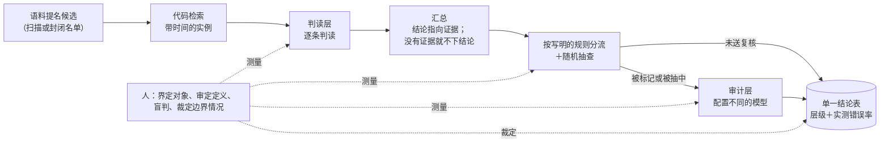

# CMH Skills：语料—模型—人 核验

[English](README.md)

这是一个智能体 skill，外加一套小型 Python 工具，用于让语言模型阅读语料实例的语言学与社会科学研究：判词义、
给首现定年、按编码手册给文档编码、判立场或框架。它提供工作流程、模板和脚本，让结果可以被核查，并且写明哪些事必须由人自己做。

skill 采用 Claude Code 及其他支持 agent skills 的智能体所用的 `SKILL.md` 格式。脚本是普通 Python
（3.11 及以上，只用标准库），不借助任何智能体也能用。

## 我们的主张

我们不相信语言模型，但仍然要让它做出可靠的工作。

CMH 不会让模型变得可信。它安排工作的方式，让结论不必依赖对模型的信任：

- 每个结论都落在从语料里检索到的实例上，从不依赖模型的记忆；
- 每一个模型层都用人的盲判去测量；
- 每个报告出来的结果都带着证据层级和该层级实测的错误率；
- 证据不够，就不下结论。

## CMH 模型

CMH 把核验分给**语料**、**模型**和**人**三方。



### 各项机制

| 机制 | 做什么 | 防止什么 |
|---|---|---|
| 语料提名 | 候选来自对语料的扫描，或完整使用的封闭名单；模型只做分类，只有语料提名不到的地方才让模型枚举 | 候选清单只限于某人碰巧想到的东西 |
| 由代码检索 | 代码取出带时间和上下文的实例；从不让模型提供年代、出处或例句 | 凭模型记忆编出来的年代和例句 |
| 判读层 | 每条实例按审定过的定义调用一次模型；每次调用都写进只追加的台账 | 悄悄重跑、输出丢失、提示词版本混用 |
| 汇总与弃权 | 结论指向它所依据的实例；没有实例，这个单元就没有结论；落在来源时间窗口边缘的值标为界限 | 不管有没有证据都给每个单元一个答案；只是窗口算术造成的“趋势” |
| 按写明的规则分流 | 用写下来的规则（极短或歧义大的词形、窗口边缘、孤立的早期命中、只有一条支持实例）把结论送去复核，其余的再带种子随机抽查一部分 | 依赖模型的置信度——模型标不出它有把握的错误 |
| 审计层 | 配置不同的模型重读送来复核的结论；它的误推翻也要测量 | 自己确认自己；盲目相信更强的模型 |
| 人的标尺 | 独立的盲判标签：先测人与人之间，再测每一层，按语言、按类别 | 模型的数字没有可对照的参照 |
| 裁决 | 研究者裁定取决于“研究对象是什么”的情况，并记录下来 | 边界问题被偶然或被多数决随手定掉 |
| 证据层级 | 每个结论带着证据的强弱等级；低层级不能覆盖高层级；检索命中数只给界限 | 把弱证据当强证据报告 |
| 冻结协议 | 定义、提示词、规则和解读规则在评估之前做哈希并提交 | 看了结果再改规则 |
| 单一结论表、核对与仪表 | 每个数字都来自同一张表；每次重建都跑写好的核对项和版本比对；只读视图（漏斗、一致度、成本……）自动重算 | “测试全部通过”背后的数据串行、被覆盖的人工输入、手算的数字 |

## 人要做什么

| 谁 | 任务 | 时间 |
|---|---|---|
| 研究者 | 界定分析单位、要判的属性、结论、观察窗 | 任何东西运行之前 |
| 研究者 | 决定每个来源能支撑什么（证据层级） | 任何东西运行之前 |
| 研究者 | 逐条阅读并审定定义或编码手册 | 模型使用之前 |
| 两名及以上标注者 | 独立完成一份盲判试标，弄清人与人在各类别上的一致度 | 选择模型之前 |
| 研究者 | 冻结协议，包括每种可能结果代表什么 | 评估运行之前 |
| 两到三位读者 | 对每个条件的产出做盲判，作为每一层的真值 | 流水线跑完之后 |
| 研究者 | 裁定边界情况并记录 | 随时 |
| 研究者 | 确认结果和每个结论的措辞 | 发表之前 |

给了用来核对的文件时，脚本会拒绝几种走捷径的做法：没标为已审定的定义、冻结后又被改动的协议文件、会把模型答案或来源显示给标注者的卷子、
放在卷子文件夹里面的答案键文件夹。上面这些任务，代码替你做不了。

## 适用于

结论要靠逐条阅读语料实例得出、书面定义可以由受过训练的人来执行、并且能抽取人工盲判样本的研究：

- **定年**：词、词义、借词、新词、术语、口号的首现；
- **比例与趋势**：各时期的义项占比、框架或立场占比、议题占比；
- **有无**：某个时期或语域里有没有某种用法（附实测的漏报率）；
- **比较**：语域之间、媒体之间、国家之间、平行语料；
- **编码变量**：按编码手册给文档编码，并在进入统计模型之前校正。

不同结论类型要调整什么，见 `skills/cmh-corpus-verification/references/scenarios.zh-CN.md`。

## 不适用于

- 不需要阅读实例的统计（频率、搭配、词向量）；
- 受过训练的人也判不一致的任务：先改定义；
- 没有任何语料能证实的事实：模型的记忆不是证据；
- 针对具体个人的决定（医疗、法律、招聘、内容审核、监控）；
- 你无权处理的材料（版权、使用条款、个人信息、伦理审查）；
- 完全没有人力投入的项目。

## 安装

需要 Python 3.11 及以上，不需要第三方包。

在 Claude Code 里使用：把 skill 文件夹复制（或建符号链接）到个人或项目的 skills 目录：

```bash
git clone https://github.com/<owner>/cmh-skills.git
cp -r cmh-skills/skills/cmh-corpus-verification ~/.claude/skills/
# 只给某个项目用：cp -r cmh-skills/skills/cmh-corpus-verification <项目>/.claude/skills/
```

其他读取 `SKILL.md` 的智能体：把文件夹放到该智能体查找 skills 的位置。
不用智能体：直接运行脚本，每个脚本都有 `--help`。

## 快速上手

在合成的小语料上离线跑完整流程（模型用关键词替身代替，三位读者是模拟的）：

```bash
python3 examples/toy/run_example.py
python3 -m unittest discover -s tests
```

做真实研究时，把 `skills/cmh-corpus-verification/templates/` 复制到你的项目里，填好协议，按
`references/workflow.zh-CN.md` 一步步做。判读层可以接任何提供 OpenAI 兼容接口的模型（本地服务或云端 API），也可以接任意命令行程序。

## 仓库结构

```
skills/cmh-corpus-verification/
  SKILL.md, SKILL.zh-CN.md      skill 本体（英文给智能体读；旁边是中文版）
  references/                   工作流程、场景、证据、标注、统计、常见失误（中英两版）、术语表
  templates/                    协议、提示词、判读／审计配置、分流规则、结论表核对规则、数字登记表、标注说明
  scripts/                      cmh_*.py 工具（只用标准库）
examples/toy/                   合成数据的端到端示例
tests/                          单元测试与端到端测试
```

## 安全与隐私

- 脚本只读写你指定的文件。除非你配置了模型后端，否则不向任何地方发送任何内容；配置之后，`cmh_judge.py` 也只调用配置里写的接口或程序。
- API 密钥在运行时从环境变量读取，从不写入文件。
- 台账默认不保存完整提示词，因为里面有语料原文；需要时可以打开。
- `command` 后端会执行配置文件里写的程序。别人给的配置文件，要像读代码一样先读一遍再运行。
- 不要把语料、答案键、含语料原文的台账或密钥提交到仓库。`.gitignore` 已经涵盖了常见的文件名。
- 给标注者的卷子里，表格软件可能当作公式执行的单元格都做了转义。

详见 [SECURITY.md](SECURITY.md)，其中也写了如何报告安全问题。

## 免责声明

本项目按“原样”提供，不附带任何形式的担保。它是一个方法上的辅助工具，不保证结果正确。作者和贡献者不对任何使用方式及其后果负责，
包括研究结论、发表、决定、数据处理、模型服务费用，以及是否符合法律、许可、服务条款、数据保护规定或伦理要求。
数据、模型、配置和结论由使用者自行负责。全文见 [DISCLAIMER.md](DISCLAIMER.md)。

## 许可

MIT，见 [LICENSE](LICENSE)。

## 参与贡献

欢迎提 issue 和 pull request。请先读 [CONTRIBUTING.md](CONTRIBUTING.md)：只用合成数据、不放任何密钥、统计方面的改动都要附测试、中英文档同步更新。
