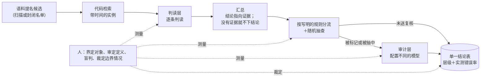

# CMH Skills：语料—模型—人 核验

[English](README.md)

**版本 1.0.0** · [更新日志](CHANGELOG.md)

这是一个 [Agent Skills](https://agentskills.io) 格式的 skill，外加一套小型 Python 工具，用于让语言模型阅读语料实例的语言学与社会科学研究：
判词义、给首现定年、按编码手册给文档编码、判立场或框架。它给你的智能体提供工作流程、模板和脚本，让结果可以被核查，并且写明哪些事必须由人自己做。

适用于 Claude Code、Codex、Cursor、Gemini CLI、GitHub Copilot、OpenCode、Cline、Amp 等能读取 `SKILL.md` 的智能体。
脚本是普通的 Python（3.11 及以上，只用标准库），不借助智能体也能用。

## 30 秒开始

```bash
npx skills add https://github.com/subarasi520/cmh-skills --skill cmh-corpus-verification -g
```

需要 Node.js 22.20 或以上。安装时会问你装到哪几个智能体。去掉 `-g` 就只装到当前项目。

也可以直接把这段话发给有 shell 权限的 AI 智能体：

```text
帮我安装 cmh-corpus-verification 这个 skill。如果有 Node.js（22.20 或以上），运行：npx skills add https://github.com/subarasi520/cmh-skills --skill cmh-corpus-verification -g -y。如果没有，就把 https://github.com/subarasi520/cmh-skills 克隆下来，把其中的 skills/cmh-corpus-verification 整个文件夹复制到你读取 skills 的目录（Claude Code 是 ~/.claude/skills/；Codex、Cursor、Gemini CLI、GitHub Copilot、OpenCode 等大多数智能体是 ~/.agents/skills/）。装好后告诉我装在哪里，以及 SKILL.md 里写的版本号。
```

已经安装过的话，用这段话更新：

```text
帮我更新 cmh-corpus-verification 这个 skill。如果是用 skills 命令行装的，运行：npx skills update cmh-corpus-verification -g -y。如果是从克隆的仓库复制过去的，进入克隆目录执行 git pull，再把 skills/cmh-corpus-verification 重新复制过去。然后告诉我 SKILL.md 里写的版本号。
```

装好后直接对智能体说：

```text
我有一份带日期的报纸语料，想弄清“粉丝”从哪一年开始有“追星的人”这个意思。请按 CMH 流程帮我设计研究，并告诉我每一步需要我做什么。
```

也可以试这些请求：

```text
把这份编码手册和 300 篇议会发言的随机样本做成盲判卷，给两位标注者各一份。
这是两位标注者交回的卷子，按类别算一致度，告诉我哪一类分歧最大。
模型已经给 2 万篇新闻标了框架，另有 400 篇随机抽出的新闻由人判过，帮我校正每一年的框架占比。
检查这份稿子里的每个数字能不能对回结果文件。
```

## 研究示例

下面是这套流程适用的几种研究设计，写出来是为了让你看清每一部分在做什么。它们是示意，不是已经完成的研究。

**1. “粉丝”从哪一年开始指“追星的人”？**（定年）
代码从带日期的报纸语料里逐年取出所有含“粉丝”的句子。模型逐句判断它指追星的人还是食物（“粉丝炖白菜”对“粉丝排队要签名”）。
结果是最早出现“追星的人”这个意思、并经过核实的年份，附上那一句原文；如果这一年正好是语料的第一年，就报告为“不晚于这一年”。
人要做的：审定定义、做一份盲判样本、查看分流规则标出的每一条早期命中。

**2. 二十世纪里英语 gay 的词义怎样变化？**（各时期的比例）
模型把历史语料里每一次出现标为“快乐”“同性恋”或“判断不了”。结果是每个十年里各义项的占比，并用人在每个十年里随机抽判的样本校正。
人要做的：界定义项、决定“判断不了”怎么计、判各个十年的样本。

**3. “很＋名词”（很中国、很绅士）在扩散吗？**（比例，语域之间比较）
模型判断“很”后面是当作性质用的名词，还是别的成分（很好、很多人）。结果是报纸、小说、论坛三种语域逐年的占比。
只有在每个语域里分别测过一致度之后，才报告语域之间的差异。

**4. 词典给的首个书证能不能再往前推？**（定年、有无）
模型检查数字化书刊里早于词典首证年份的段落。找到的更早书证，每一条都经人确认后，连同原文一起报告；
找不到时，结论写作“某年以前未观察到”，并附上实测的漏报率。

**5. 议会发言怎样为移民问题设定框架？**（编码、比例、比较）
模型按编码手册给每段发言编码（经济、安全、人道、文化、其他）。结果是各年份、各政党的框架占比，并用人工编码的随机样本校正。
人要做的：编写并审定编码手册、先一起试编、按政党分别检查一致度。

**6. 企业从什么时候开始承诺碳中和？**（按单元定年）
模型判断年报里的某段话是企业自己作出的承诺（带目标年份），还是只是提到这个词。结果是每家企业第一次作出承诺的年报，
以及各年份、各行业作出承诺的企业占比。人要做的：界定什么算承诺、裁定措辞模棱两可的情况。

**7. 人们说自己为什么没去投票？**（编码变量进入统计模型）
模型按理由编码手册（没时间、不信任、没有合适的候选人……）给问卷的开放式回答编码，编码再和年龄、教育程度一起进入回归分析。
用人工编码的随机子样本校正估计，校正前后的结果并列报告。

**8. 两个国家的报纸报道同一事件有没有不同？**（跨语言比较）
模型判断每篇报道对某项政策的立场。只有在两种语言里分别测过人与模型的一致度之后，才比较立场占比：
模型可能在一种语言里判得好、在另一种语言里判得差，那时比较出来的是模型，而不是两国的报纸。

## 我们的主张

我们不相信语言模型，但仍然要让它做出可靠的工作。

CMH 不会让模型变得可信。它安排工作的方式，让结论不必依赖对模型的信任：

- 每个结论都落在从语料里检索到的实例上，从不依赖模型的记忆；
- 每一个模型层都用人的盲判去测量；
- 每个报告出来的结果都带着证据层级和该层级实测的错误率；
- 证据不够，就不下结论。

## CMH 模型

CMH 把核验分给**语料**、**模型**和**人**三方。



### 各项机制

| 机制 | 做什么 | 防止什么 |
|---|---|---|
| 语料提名 | 候选来自对语料的扫描，或完整使用的封闭名单；模型只做分类，只有语料提名不到的地方才让模型枚举 | 候选清单只限于某人碰巧想到的东西 |
| 由代码检索 | 代码取出带时间和上下文的实例；从不让模型提供年代、出处或例句 | 凭模型记忆编出来的年代和例句 |
| 判读层 | 每条实例按审定过的定义调用一次模型；每次调用都写进只追加的台账 | 悄悄重跑、输出丢失、提示词版本混用 |
| 汇总与弃权 | 结论指向它所依据的实例；没有实例，这个单元就没有结论；落在来源时间窗口边缘的值标为界限 | 不管有没有证据都给每个单元一个答案；只是窗口算术造成的“趋势” |
| 按写明的规则分流 | 用写下来的规则（极短或歧义大的词形、窗口边缘、孤立的早期命中、只有一条支持实例）把结论送去复核，其余的再带种子随机抽查一部分 | 依赖模型的置信度——模型标不出它有把握的错误 |
| 审计层 | 配置不同的模型重读送来复核的结论；它的误推翻也要测量 | 自己确认自己；盲目相信更强的模型 |
| 人的标尺 | 独立的盲判标签：先测人与人之间，再测每一层，按语言、按类别 | 模型的数字没有可对照的参照 |
| 裁决 | 研究者裁定取决于“研究对象是什么”的情况，并记录下来 | 边界问题被偶然或被多数决随手定掉 |
| 证据层级 | 每个结论带着证据的强弱等级；低层级不能覆盖高层级；检索命中数只给界限 | 把弱证据当强证据报告 |
| 冻结协议 | 定义、提示词、规则和解读规则在评估之前做哈希，并提交锁文件 | 看了结果再改规则 |
| 单一结论表、核对与仪表 | 每个数字都来自同一张表；每次重建都跑写好的核对项和版本比对；只读视图（漏斗、一致度、成本……）自动重算 | “测试全部通过”背后的数据串行、被覆盖的人工输入、手算的数字 |

## 人要做什么

| 谁 | 任务 | 时间 |
|---|---|---|
| 研究者 | 界定分析单位、要判的属性、结论、观察窗 | 任何东西运行之前 |
| 研究者 | 决定每个来源能支撑什么（证据层级） | 任何东西运行之前 |
| 研究者 | 逐条阅读并审定定义或编码手册 | 模型使用之前 |
| 两名及以上标注者 | 独立完成一份盲判试标，弄清人与人在各类别上的一致度 | 选择模型之前 |
| 研究者 | 冻结协议，包括每种可能结果代表什么 | 评估运行之前 |
| 两到三位读者 | 对每个条件的产出做盲判，作为每一层的真值 | 流水线跑完之后 |
| 研究者 | 裁定边界情况并记录 | 随时 |
| 研究者 | 确认结果和每个结论的措辞 | 发表之前 |

给了用来核对的文件时，脚本会拒绝几种走捷径的做法：没标为已审定的定义、冻结后又被改动的协议文件、会把模型答案或来源显示给标注者的卷子、
放在卷子文件夹里面的答案键文件夹。上面这些任务，代码替你做不了。

## 不适用于

- 不需要阅读实例的统计（频率、搭配、词向量）；
- 受过训练的人也判不一致的任务：先改定义；
- 没有任何语料能证实的事实：模型的记忆不是证据；
- 针对具体个人的决定（医疗、法律、招聘、内容审核、监控）；
- 你无权处理的材料（版权、使用条款、个人信息、伦理审查）；
- 完全没有人力投入的项目。

不同结论类型要调整什么，见 `skills/cmh-corpus-verification/references/scenarios.zh-CN.md`。

## 手动安装

把 `skills/cmh-corpus-verification` 这个文件夹（不是整个仓库）复制到你的智能体读取 skills 的目录：

| 智能体 | 所有项目可用 | 只给一个项目 |
|---|---|---|
| Claude Code | `~/.claude/skills/` | `.claude/skills/` |
| Codex、Cursor、Gemini CLI、GitHub Copilot、OpenCode、Cline、Amp 等（skills 命令行使用的共享目录） | `~/.agents/skills/` | `.agents/skills/` |
| 其他智能体 | 见 [skills 命令行的智能体列表](https://github.com/vercel-labs/skills/blob/main/docs/agents.md) 或该智能体的文档 | |
| 不支持 skill 的智能体 | 让它读 `skills/cmh-corpus-verification/SKILL.md` 并照着做 | |

```bash
git clone https://github.com/subarasi520/cmh-skills.git
cp -r cmh-skills/skills/cmh-corpus-verification ~/.agents/skills/     # 或 ~/.claude/skills/
```

## 离线试一下

示例用合成的小语料，几秒钟跑完整个流程。模型用关键词替身代替，三位读者是模拟的。

```bash
python3 examples/toy/run_example.py
python3 -m unittest discover -s tests
```

做真实研究时，把 `skills/cmh-corpus-verification/templates/` 复制到你的项目里，填好协议，按
`references/workflow.zh-CN.md` 一步步做。判读层可以接任何提供 OpenAI 兼容接口的模型（本地服务或云端 API），也可以接任意命令行程序。

## 仓库结构

```
skills/cmh-corpus-verification/
  SKILL.md, SKILL.zh-CN.md      skill 本体（英文给智能体读；旁边是中文版）
  references/                   工作流程、场景、证据、标注、统计、常见失误（中英两版）、术语表
  templates/                    协议、提示词、判读／审计配置、分流规则、结论表核对规则、数字登记表、标注说明
  scripts/                      cmh_*.py 工具（只用标准库）
examples/toy/                   合成数据的端到端示例
tests/                          单元测试与端到端测试
```

## 安全与隐私

- skill 以你的智能体的权限运行。安装前请先读一遍 `SKILL.md` 和脚本。
- 脚本只读写你指定的文件。除非你配置了模型后端，否则不向任何地方发送任何内容；配置之后，`cmh_judge.py` 也只调用配置里写的接口或程序。
- API 密钥在运行时从环境变量读取，从不写入文件。
- 台账默认不保存完整提示词，因为里面有语料原文；需要时可以打开。
- `command` 后端会执行配置文件里写的程序。别人给的配置文件，要像读代码一样先读一遍再运行。
- 不要把语料、答案键、含语料原文的台账或密钥提交到仓库。`.gitignore` 已经涵盖了常见的文件名。
- 给标注者的卷子里，表格软件可能当作公式执行的单元格都做了转义。
- `skills` 安装工具是第三方工具（[vercel-labs/skills](https://github.com/vercel-labs/skills)），默认会发送匿名的安装统计；设置 `DISABLE_TELEMETRY=1` 可以关闭。

详见 [SECURITY.md](SECURITY.md)，其中也写了如何报告安全问题。

## 免责声明

本项目按“原样”提供，不附带任何形式的担保。它是一个方法上的辅助工具，不保证结果正确。作者和贡献者不对任何使用方式及其后果负责，
包括研究结论、发表、决定、数据处理、模型服务费用，以及是否符合法律、许可、服务条款、数据保护规定或伦理要求。
数据、模型、配置和结论由使用者自行负责。全文见 [DISCLAIMER.md](DISCLAIMER.md)。

## 许可

MIT，见 [LICENSE](LICENSE)。

## 参与贡献

欢迎提 issue 和 pull request。请先读 [CONTRIBUTING.md](CONTRIBUTING.md)：只用合成数据、不放任何密钥、统计方面的改动都要附测试、中英文档同步更新。
